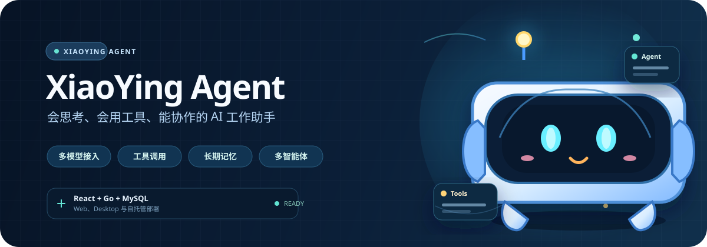
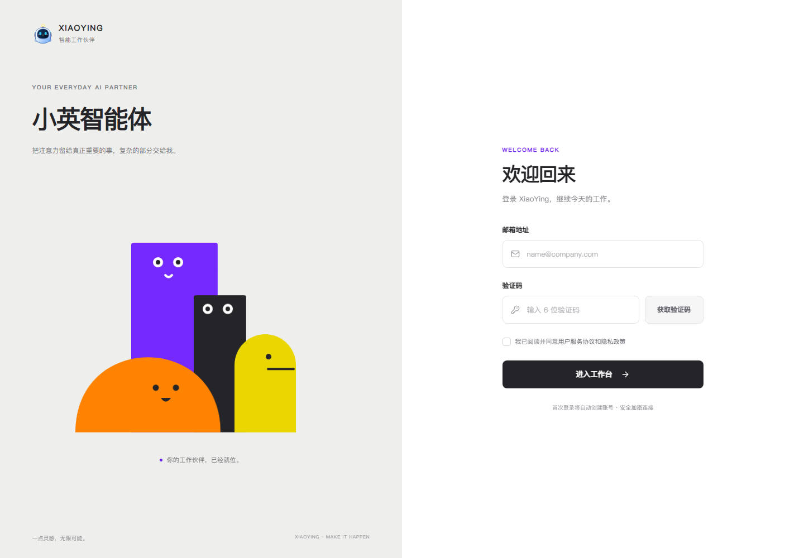
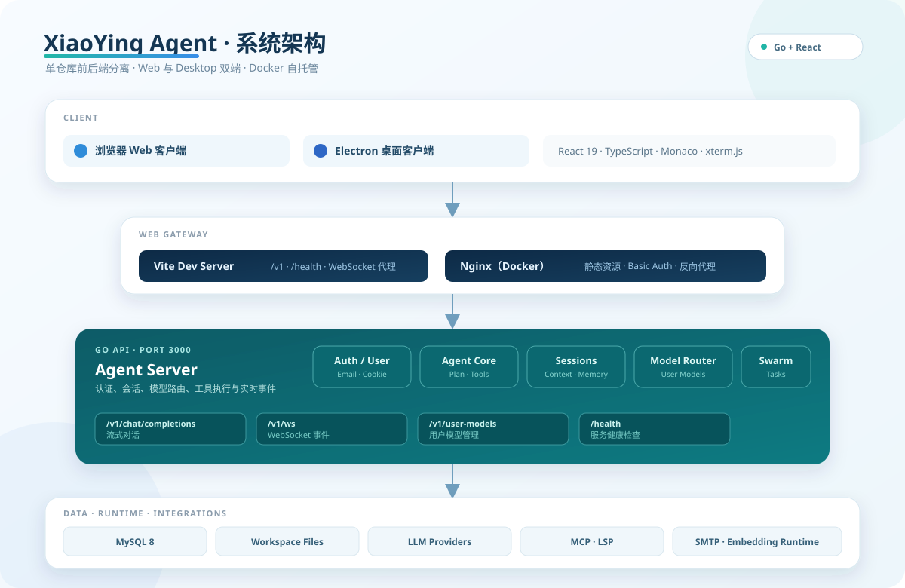

<p align="center">
  
</p>

<p align="center">
  <a href="https://github.com/zhouzefeng123/xiaoying-agent">
    
  </a>
  
  
  
  
</p>

<h1 align="center">XiaoYing Agent</h1>

<p align="center">
  一个面向个人与团队的多模型 AI 工作助手，支持浏览器、Electron 桌面端和 Docker 自托管部署。
</p>

<p align="center">
  <a href="#界面预览">界面预览</a> ·
  <a href="#核心能力">核心能力</a> ·
  <a href="#系统架构">系统架构</a> ·
  <a href="#快速开始">快速开始</a> ·
  <a href="#配置说明">配置说明</a>
</p>

## 界面预览

<p align="center">
  
  <br>
  <sub>Web 登录界面 · 截图来自当前项目实际运行版本</sub>
</p>

## 为什么选择 XiaoYing Agent

XiaoYing Agent 将对话、模型管理、工具调用、长期记忆、文档处理和多智能体协作整合在同一套工作区中。前后端分离的架构让它可以作为桌面应用运行，也可以部署为多人访问的 Web 服务。

> [!NOTE]
> 项目仍在积极开发中。接口、配置和界面可能持续调整；生产部署前请先阅读[安全提示](#安全提示)，并完成密钥、数据库和访问控制配置。

## 核心能力

| 能力 | 说明 |
| --- | --- |
| 多模型对话 | 接入 OpenAI、DeepSeek、Anthropic、Gemini、通义千问、Groq、OpenRouter、Azure OpenAI 等服务。 |
| 用户模型管理 | 在网页端添加、编辑和切换自定义模型，支持自定义服务地址、模型名称和供应商配置。 |
| Agent 工具调用 | 读写文件、修改代码、执行命令、搜索仓库、访问网页并完成多步骤任务。 |
| 会话与上下文 | 会话历史、自动压缩、上下文窗口控制、知识检索与长期记忆。 |
| 多智能体协作 | 任务拆分、子 Agent、并行执行、消息广播和结果汇总。 |
| 文档与办公 | 内置 Word 编辑能力，并提供 Excel、PPT、PDF 等文档技能。 |
| 语音交互 | 支持语音识别、TTS 和唤醒词等浏览器或桌面端能力。 |
| MCP 与 LSP | 接入 MCP 工具服务器，并通过 LSP 获取代码补全、诊断和语言服务信息。 |
| 定时任务 | 按用户管理后台任务、执行结果和通知事件。 |
| Web 与桌面 | 同一前端同时支持浏览器访问和 Electron 桌面打包。 |

## 系统架构

<p align="center">
  
</p>

核心数据流：

1. 浏览器或 Electron 客户端加载 React 界面。
2. 开发环境由 Vite 代理请求，生产环境由 Nginx 提供静态资源并反向代理 `/v1`。
3. Go API 完成登录鉴权、模型路由、Agent 编排、工具执行和 WebSocket 推送。
4. MySQL 保存会话与业务数据，工作区目录保存文件，外部模型、SMTP、MCP 和 LSP 提供扩展能力。

## 技术栈

| 模块 | 技术 |
| --- | --- |
| Web 前端 | React 19、TypeScript、Vite、Tailwind CSS |
| 桌面端 | Electron、electron-builder |
| 编辑器与终端 | Monaco Editor、xterm.js |
| 后端 | Go 1.25、Cobra、WebSocket |
| 数据库 | MySQL 8.0；支持从旧版 SQLite 导入 |
| AI 能力 | 多 LLM Provider、MCP、LSP、Embedding |
| 部署 | Docker Compose、Nginx |

## 项目结构

```text
xiaoying-agent/
├── docs/
│   └── images/                 # README 截图与架构图
├── deploy/                     # Docker Compose 部署
│   ├── .env.example            # 环境变量模板
│   ├── docker-compose.yml      # MySQL + Go API + Nginx Web
│   └── nginx.conf
├── xiaoying-agent-api/         # Go 后端
│   ├── cmd/                    # 服务、迁移与工具命令
│   ├── internal/               # Agent、认证、模型、数据库与工具
│   ├── system_skills/          # 内置技能
│   └── main.go
├── xiaoying-agent-web/         # React / Electron 前端
│   ├── electron/               # Electron 主进程与预加载脚本
│   ├── src/                    # 页面、组件与业务逻辑
│   └── vite.web.config.ts      # Web 开发代理
├── README.md
└── .gitignore
```

## 快速开始

### 环境要求

- Docker 24+ 与 Docker Compose v2，或
- Node.js 22+、npm 10+、Go 1.25+、MySQL 8.0

### 方式一：Docker Compose 启动

以下命令会启动 MySQL、Go API 和 Nginx Web 页面。

1. 克隆项目：

```bash
git clone https://github.com/zhouzefeng123/xiaoying-agent.git
cd xiaoying-agent
```

2. 创建部署目录并复制配置模板：

```powershell
New-Item -ItemType Directory -Force .\deploy\config
New-Item -ItemType Directory -Force .\deploy\data\workspace
New-Item -ItemType Directory -Force .\deploy\data\database
New-Item -ItemType Directory -Force .\deploy\data\logs
Copy-Item .\deploy\.env.example .\deploy\.env
Copy-Item .\xiaoying-agent-api\.run\auramate.with-db.json .\deploy\config\.auramate.json
```

macOS / Linux：

```bash
mkdir -p deploy/config deploy/data/workspace deploy/data/database deploy/data/logs
cp deploy/.env.example deploy/.env
cp xiaoying-agent-api/.run/auramate.with-db.json deploy/config/.auramate.json
```

3. 编辑 `deploy/.env`，至少替换数据库密码、Web Basic Auth、邮箱白名单和 SMTP 配置。

4. 编辑 `deploy/config/.auramate.json`，填写实际模型服务配置和 API Key。

5. 构建并启动：

```bash
cd deploy
docker compose up -d --build
docker compose ps
```

6. 打开 `http://localhost/`，输入 Basic Auth 账号后，再使用白名单邮箱验证码登录。

健康检查：

```bash
curl -u admin:你的BasicAuth密码 http://127.0.0.1/health
```

查看日志或停止服务：

```bash
docker compose logs -f --tail=200 api
docker compose down
```

普通的 `docker compose down` 不会删除 MySQL volume 中的数据。

### 方式二：本地开发

#### 1. 启动 MySQL

使用已有 MySQL 8.0 实例，或通过 Docker 单独启动数据库：

```bash
docker run -d --name xiaoying-mysql -p 3306:3306 \
  -e MYSQL_ROOT_PASSWORD=xiaoying \
  -e MYSQL_DATABASE=auramate \
  mysql:8.0 \
  --character-set-server=utf8mb4 \
  --collation-server=utf8mb4_unicode_ci
```

#### 2. 启动 Go 后端

```powershell
Copy-Item .\xiaoying-agent-api\.run\auramate.with-db.json .\xiaoying-agent-api\.auramate.json
cd .\xiaoying-agent-api
go mod download
go run . server --port 3000
```

验证后端：

```powershell
Invoke-RestMethod http://localhost:3000/health
```

#### 3. 启动 Web 前端

另开一个终端：

```powershell
cd .\xiaoying-agent-web
npm ci
npm run dev:web
```

浏览器访问：

```text
http://localhost:5173
```

Vite 会把 `/v1`、WebSocket 和 `/health` 请求代理到 `http://localhost:3000`。需要让同一局域网内的设备访问时，可运行：

```powershell
npm run dev:web -- --host 0.0.0.0
```

#### 4. 启动 Electron 桌面端

```powershell
cd .\xiaoying-agent-web
npm run dev
```

## 配置说明

### 常用环境变量

| 环境变量 | 说明 | 默认值 |
| --- | --- | --- |
| `AURAMATE_DB_HOST` | MySQL 主机 | `127.0.0.1` |
| `AURAMATE_DB_PORT` | MySQL 端口 | `3306` |
| `AURAMATE_DB_USER` | MySQL 用户 | `root` |
| `AURAMATE_DB_PASSWORD` | MySQL 密码 | 空 |
| `AURAMATE_DB_NAME` | 数据库名 | `auramate` |
| `AURAMATE_CONFIG_FILE` | 配置文件路径 | 自动查找 |
| `AURAMATE_WORKSPACE` | Agent 工作区路径 | 自动创建 |
| `AURAMATE_AUTH_ALLOWED_EMAILS` | 登录邮箱白名单 | 空 |
| `AURAMATE_SMTP_HOST` | SMTP 服务器 | 空 |
| `AURAMATE_SMTP_PORT` | SMTP 端口 | `465` |
| `AURAMATE_SMTP_TLS` | `ssl` 或 `starttls` | `ssl` |
| `AURAMATE_COOKIE_SECURE` | HTTPS 环境设为 `true` | `false` |

邮箱白名单支持逗号分隔和域名通配：

```dotenv
AUTH_ALLOWED_EMAILS=admin@example.com,*@example.org
```

### 模型配置

模型配置位于 `.auramate.json`，常见位置包括：

- 项目目录：`./.auramate.json`
- 用户目录：`~/.auramate.json`
- `AURAMATE_CONFIG_FILE` 指定的路径

简化示例：

```json
{
  "main_model": {
    "provider": "openai",
    "baseURL": "https://api.deepseek.com",
    "model": "deepseek-chat",
    "apiKey": "replace-with-your-key"
  },
  "providers": {
    "openai": {
      "apiKey": "replace-with-your-key",
      "disabled": false
    }
  }
}
```

也可以使用以下环境变量接入模型：

| 环境变量 | 用途 |
| --- | --- |
| `OPENAI_API_KEY` | OpenAI 或兼容服务 |
| `ANTHROPIC_API_KEY` | Anthropic Claude |
| `GEMINI_API_KEY` | Google Gemini |
| `GROQ_API_KEY` | Groq |
| `GITHUB_TOKEN` | GitHub Copilot |
| `LOCAL_ENDPOINT` | OpenAI 兼容的本地模型服务 |

不要提交包含真实 API Key、SMTP 授权码或数据库密码的配置文件。

## 常用 API

| 路径 | 说明 |
| --- | --- |
| `GET /health` | 服务健康检查 |
| `POST /v1/chat/completions` | 流式对话 |
| `GET /v1/ws` | WebSocket 事件通道 |
| `GET/POST /v1/user-models` | 用户模型配置管理 |
| `GET /v1/models` | 可用模型列表 |
| `GET /v1/sessions` | 用户会话列表 |
| `GET /v1/memories` | 长期记忆 |
| `GET /v1/tasks` | 定时任务 |
| `POST /v1/auth/send-email-code` | 发送邮箱验证码 |
| `POST /v1/auth/login` | 邮箱验证码登录 |

除健康检查和认证配置外，大多数 `/v1` 接口需要有效登录会话。

## 构建与测试

### Web 与 Electron

```powershell
cd .\xiaoying-agent-web
npm ci
npm exec vitest run
npm run build
npm run lint
```

生成 Electron 安装包：

```powershell
npm run package
```

### Go 后端

```powershell
cd .\xiaoying-agent-api
go test ./...
go build -o auramate.exe .
```

macOS / Linux：

```bash
cd xiaoying-agent-api
go test ./...
go build -o auramate .
```

部分集成测试依赖 MySQL、模型 API Key 或外部服务；缺少依赖时，请以能够独立运行的单元测试结果为准。

## 部署与数据

| 数据 | Docker 部署位置 |
| --- | --- |
| MySQL | Docker volume `xiaoying_mysql_data` |
| 用户工作区 | `deploy/data/workspace` |
| 后端日志 | `deploy/data/logs` |
| 应用配置 | `deploy/config/.auramate.json` |

以下内容不应提交到 Git：

- `.env`
- `.auramate.json`
- `database/*.db`
- `workspace/`
- `logs/`
- `node_modules/`
- `dist/`
- `release-v2/`
- 用户模型凭据目录

## 安全提示

- Agent 能执行命令并修改工作区文件，只应授权给可信用户使用。
- 不要把 Go 后端 `3000` 端口直接暴露到公网，应通过 Nginx 或网关访问。
- 生产环境请关闭调试日志，并为 Web 入口增加认证、HTTPS 和访问频率限制。
- Web 端已经按用户隔离会话、工作区和大部分业务数据，但这属于应用层隔离，不等同于容器级安全沙箱。
- 需要每次工具调用前确认时，可在配置中设置：

```json
{
  "security": {
    "allowAllTools": false
  }
}
```

- 定期备份 MySQL 数据、工作区文件和部署配置。

## 更多文档

- 后端说明：[xiaoying-agent-api/README.md](./xiaoying-agent-api/README.md)
- 前端说明：[xiaoying-agent-web/README.md](./xiaoying-agent-web/README.md)
- Docker 部署与多用户说明：[deploy/README.md](./deploy/README.md)

## 参与贡献

1. Fork 本仓库并创建功能分支。
2. 完成修改后运行相关构建和测试。
3. 在 Pull Request 中说明改动范围、验证方式和潜在风险。

项目仓库：[https://github.com/zhouzefeng123/xiaoying-agent](https://github.com/zhouzefeng123/xiaoying-agent)

## 许可证

后端目录附带 [MIT License](./xiaoying-agent-api/LICENSE)。第三方依赖、内置技能和随项目分发的资源可能适用各自许可证，发布或商用前请逐一确认。
